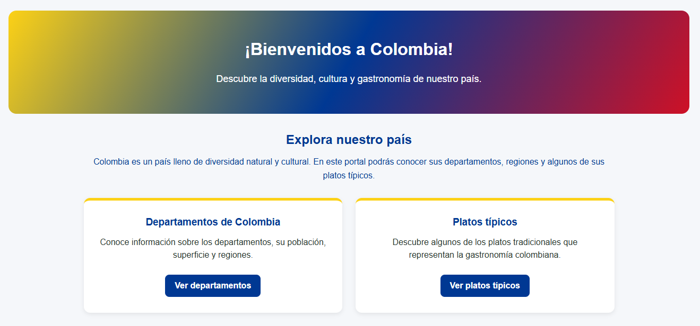
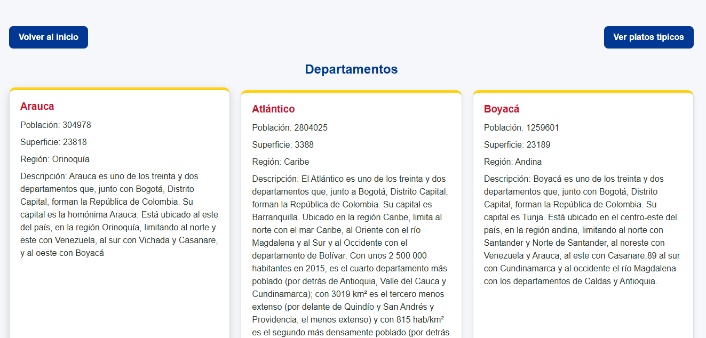
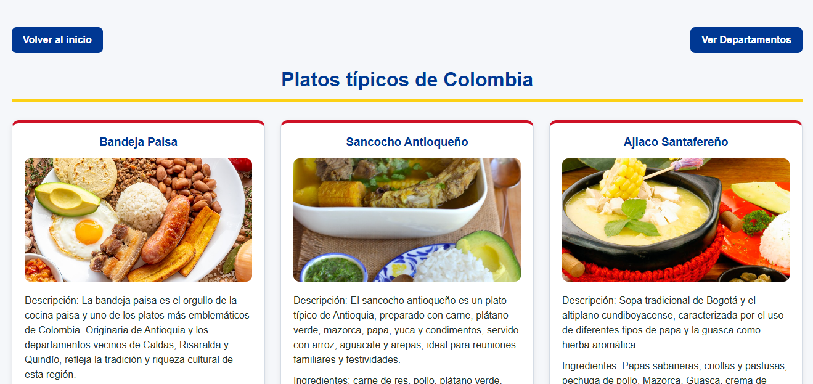

# Mini Portal de Colombia 🇨🇴

## 1. Descripción del proyecto

Mini Portal de Colombia es una página web que permite conocer información sobre los departamentos, regiones y platos típicos de Colombia.

El proyecto consume información de la API Colombia y presenta los datos de manera dinámica mediante una interfaz sencilla y fácil de navegar.

## 2. Tecnologías usadas

- **HTML5:** estructura de las páginas web.
- **CSS3:** diseño, estilos y adaptación a diferentes dispositivos.
- **JavaScript:** consumo de la API y visualización dinámica de información.
- **Fetch API:** obtención de datos desde servicios externos.
- **API Colombia:** fuente de información sobre departamentos, regiones y platos típicos.

## API utilizadas

Endpoints consultadas:

Departamentos: https://api-colombia.com/api/v1/Department

Regiones: https://api-colombia.com/api/v1/Region

Platos típicos: https://api-colombia.com/api/v1/TypicalDish

## 3. Estructura del Actividad

mini-portal-colombia/
│
├── index.html
├── departamentos.html
├── platos.html
│
├── css/
│   └── estilos.css
│
├── js/
│   ├── departamentos.js
│   └── platos.js
│
└── imagenes/
    ├── tamal.png
    ├── Arrozdelisa.png
    └── Dulcedeguayaba.png

## 4. Instrucciones de uso

1. Descargar o clonar el repositorio del proyecto.
2. Abrir la carpeta del proyecto en Visual Studio Code.
3. Ejecutar el archivo `index.html` utilizando la extensión Live Server.
4. Desde la página principal, seleccionar la sección que se desea consultar:
   - Departamentos de Colombia.
   - Platos típicos de los departamentos.
5. Navegar entre las páginas mediante los enlaces disponibles.

## 5. Capturas de pantalla

### Página de inicio

### Departamentos de Colombia

### Platos típicos

## 6. Nombre del estudiante

**Estudiante:** Juan Sebastian Sierra
